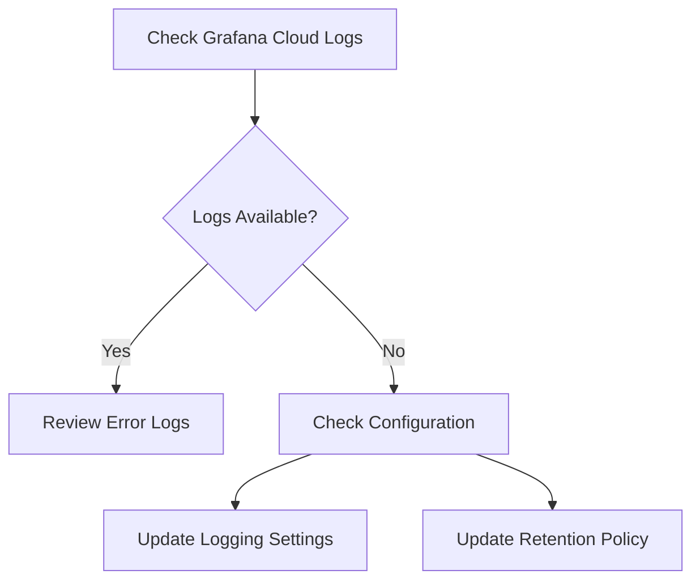

# Incident Report: todo-webapp Error

**Incident ID:** 7356374534  
**Incident Time:** 2025-12-17 17:56 IST  
**Error Time:** 2025-09-16 08:40 IST  

## Description of the Issue
A production alert was raised for a Kubernetes deployment named `todo-webapp`. The service is returning HTTP errors to end users, leading to poor user experience.

## Steps Taken to Find Root Cause
- Checked Grafana Cloud logs for the specified time range (8:40 AM IST on September 16, 2025).
- Verified the logging configuration of the `todo-webapp` to ensure errors and exceptions are being captured.
- Reviewed log retention settings in Grafana to verify the logs should still be available.

## Root Cause
No logs were retrieved for the `todo-webapp` service in the specified time frame. Possible reasons include:
- Application not logging errors appropriately.
- Log retention policy in Grafana or missing logs.
- Deployment issues affecting the app.

## Proposed Solution
1. Verify logging configuration on the `todo-webapp` to ensure that errors are properly logged.
2. Check Grafana's log retention policy to keep logs for a longer duration.
3. Investigate the deployment issues that might affect the logging functionality.

## Why Will It Work
By verifying the logging configurations and log retention policies, we can ensure that any future errors are captured, allowing for timely intervention and resolution.

## Mermaid Diagram

## Explanation of Code Fix (Beginner Level)
The logging issue means that errors may not be recorded when they happen. To fix this, we need to ensure the app is set up to record all important errors. This way, when users face issues, we can see exactly what went wrong and fix it quickly.

## Punchline
Why did the developer bring a ladder to the bar? Because they heard the drinks were on the house! 😄