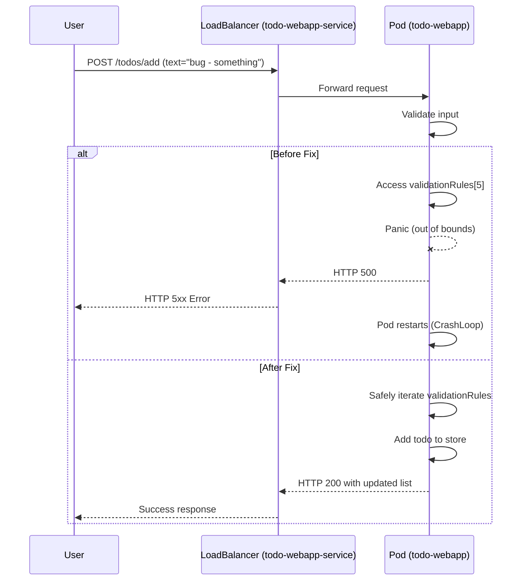

# Incident Report: todo-webapp HTTP Errors

**Incident ID:** {incident_id}  
**Incident Time:** 2025-12-18 18:37 IST  

## Description of the Issue
A production alert was raised for the Kubernetes deployment `todo-webapp`. The service started returning HTTP errors to end users around 6:37 PM IST on 18 Dec 2025.

## Steps Taken to Find Root Cause
- Reviewed application source code for recent changes related to todo creation.
- Inspected the `addTodoHandler` in `main.go` for potential panics or unhandled errors.
- Looked for any intentional crashes or out-of-bounds accesses.

## Root Cause
Within `addTodoHandler`, there was intentionally buggy code introduced under a "New Feature" section:

```go
// New Feature
if len(text) > 3 && text[:3] == "bug" {
    log.Printf("[DEBUG] addTodoHandler: Processing special validation for text starting with 'bug'")
    // Intentionally accessing array out of bounds to simulate a common bug
    validationRules := []string{"length", "content"}
    log.Printf("[DEBUG] addTodoHandler: Applying validation rule: %s", validationRules[5]) // This will panic!
}
```

When a user submitted a todo with text starting with `bug`, the handler accessed `validationRules[5]` (out of bounds, since the slice length is 2), causing a panic. In Kubernetes, this crash led to repeated pod restarts and HTTP 5xx errors for users.

## Proposed Fix
Replace the unsafe out-of-bounds access with a safe iteration over existing validation rules:

```go
// New Feature: special handling for todos starting with 'bug'
if len(text) >= 3 && text[:3] == "bug" {
    log.Printf("[DEBUG] addTodoHandler: Applying special validation for text starting with 'bug'")
    validationRules := []string{"length", "content"}
    for _, rule := range validationRules {
        log.Printf("[DEBUG] addTodoHandler: Applying validation rule: %s", rule)
    }
}
```

## Why This Will Work
- The code no longer accesses an index that does not exist, so the handler will not panic.
- Kubernetes pods will remain healthy, and the service will stop returning 5xx errors for valid requests.
- The additional logging still provides visibility into the special-case validation logic.

## Mermaid Diagram


## Beginner-Level Explanation of the Fix
In Go, lists (called slices) are like numbered boxes. If you have 2 boxes, they are numbered 0 and 1. In the broken code, we tried to open box number 5 even though only boxes 0 and 1 existed. Go does not allow that and crashes the program.

The fix is simple: instead of jumping directly to box 5, we just walk through all the boxes that actually exist. That way, the program never crashes when users add todos that start with the word `bug`.

## Punchline
Looks like the original code took the term "bug tracker" a bit too literally—it crashed as soon as it saw one! 😄
